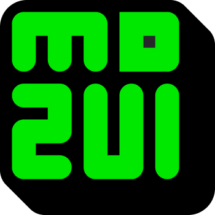

<p align="center">
  
</p>

# md2ui-ts

Markdown in, a painted, interactive UI out, with the whole pipeline running in the
browser. You give a `<md2ui-view>` element a Markdown document and, if you like, a
`THEME.md`: the layout follows the content, and the style follows the theme. Taps come back
to you as data, and the view never edits the Markdown.

One custom element works in any framework or none, with thin React and Vue components on
top and an optional client for md2ui's wire protocol.

md2ui-ts is built over [Pretext](https://github.com/chenglou/pretext), Cheng Lou's text
measurement and line-breaking library: every word the view lays out is measured and broken
into lines by Pretext.

The server side is [md2ui](https://github.com/md2ui/md2ui) (Python,
[`md2ui` on PyPI](https://pypi.org/project/md2ui/)), the reference implementation: it
tells an agent how to write for the view, checks what it wrote and streams it to the
client over the [wire protocol](https://github.com/md2ui/md2ui/blob/main/protocol/README.md).
Any server that speaks the protocol works. Home: [md2ui.org](https://md2ui.org).

**md2ui-ts is an experimental alpha.** Its API and behaviour may change between any two
releases.

## Requirements

- **Browsers:** current Chrome, Edge, Firefox and Safari, desktop and mobile (Baseline
  "widely available"), with `Intl.Segmenter`, Canvas 2D text measurement and Unicode
  property escapes. The packages are compiled to ES2024 and tested in Chromium, Firefox
  and WebKit.
- **An ESM bundler.** The packages are ESM only, with TypeScript types, and import bare
  specifiers; the examples use [Vite](https://vite.dev).
- **Module Workers.** The view runs its pipeline in a module Worker that your bundler
  ships ([where the pipeline runs](#where-the-pipeline-runs)). Without one, it runs on
  the main thread.
- **`@md2ui/wire` only:** a secure context (https or localhost), as it verifies messages
  with WebCrypto.

## Install

The packages are published under the `alpha` dist-tag:

```sh
npm i @md2ui/dom@alpha
pnpm add @md2ui/dom@alpha
yarn add @md2ui/dom@alpha
bun add @md2ui/dom@alpha
```

| You want | Install |
|---|---|
| The element, in any framework or none | `@md2ui/dom` |
| A React component | `@md2ui/dom` and `@md2ui/react` (peer: `react ^18.3 \|\| ^19`) |
| A Vue component | `@md2ui/dom` and `@md2ui/vue` (peer: `vue ^3.5`) |
| To talk to an md2ui server over its wire protocol | `@md2ui/wire`, beside the above |

`@md2ui/dom` is always needed: the React and Vue components render its element and depend
on it at their own exact version. Install it beside them, at that version, so your code
can import `defineMd2uiView` and the action types from it (pnpm lets an app import only
what it depends on itself):

```sh
npm i @md2ui/dom@alpha @md2ui/react@alpha
```

## Quick start

```ts
// vite.config.ts
import { defineConfig } from "vite";

export default defineConfig({
  // Build Workers as ES modules: the code highlighter's grammars stay chunks loaded on
  // demand. Vite's default format inlines them all into one Worker file of about 10 MB.
  worker: { format: "es" },
  // Vite 7's dev server pre-bundles @md2ui/dom without its Worker file, so the Worker
  // does not start (the view then runs on the main thread). Vite 8 needs no exclude.
  optimizeDeps: { exclude: ["@md2ui/dom"] },
});
```

```html
<!-- index.html -->
<md2ui-view style="height: 480px"></md2ui-view>
<script type="module" src="/src/main.ts"></script>
```

```ts
// src/main.ts
import { defineMd2uiView } from "@md2ui/dom";

defineMd2uiView(); // registers <md2ui-view>; nothing registers on import

const view = document.querySelector("md2ui-view");
if (view === null) throw new Error("no <md2ui-view>");

view.messageId = "m1";
view.markdown = "# Your order\n\nShip it to the office?\n\n[Yes](agent:ship) [No](agent:cancel)";

view.addEventListener("md2ui-action", (event) => {
  console.log(event.detail); // { kind: "agent", ordinal: 0, messageId: "m1", label: "Yes", slug: "ship" }
});
view.addEventListener("md2ui-error", (event) => {
  console.warn(event.detail); // { resource: "theme" | "font" | "image" | "pipeline", url, message }
});
```

That renders with md2ui's default theme. To style it, give it a `THEME.md` and the fonts
the theme names ([theme, assets and fonts](#theme-assets-and-fonts)):

```ts
view.themeSrc = "/theme/THEME.md";
view.fonts = [{ family: "EB Garamond", url: "/theme/fonts/EBGaramond-Regular.ttf" }];
```

## The element

`defineMd2uiView(options?)` registers `<md2ui-view>`. A second call does nothing, so the
first registration's options win.

| Property | Attribute | Type | What it does |
|---|---|---|---|
| `markdown` | — | `string` | The document. Setting it replaces the one shown, in place, and keeps the scroll |
| `messageId` | `message-id` | `string \| null` | Your id for the document shown; every action carries it |
| `themeSrc` | `theme-src` | `string \| null` | Where `THEME.md` is fetched from, relative to the page. Optional |
| `themeText` | — | `string \| null` | `THEME.md`'s text, given instead of fetched; wins over `themeSrc` |
| `assetBase` | `asset-base` | `string \| null` | What the theme's relative asset paths resolve against (default: `themeSrc`) |
| `fonts` | — | `FontSource[]` | The font files the theme names: `{ family, url, weight?, italic? }` |
| `disabled` | `disabled` | `boolean` | Silences the agent-bound actions, while the agent works |
| `streaming` | `streaming` | `boolean` | The message is still arriving: only its closed blocks are laid out |
| `motion` | `motion` | `"auto" \| "page" \| "edit"` | How the next document moves in, set before `markdown`: `"page"` fades it in whole (a new message), `"edit"` moves each node (a replacement), `"auto"` (default) decides by how much on screen is kept |

With neither `themeSrc` nor `themeText`, the view uses md2ui's default theme.

One method: **`release(ordinals)`** frees the buttons the view shows pending for those
ordinals, once the agent has answered them (`@md2ui/wire`'s `answered`,
[below](#the-wire-client)). A tick or a value the user set stays as set.

Two events, both bubbling out of the shadow root:

- **`md2ui-action`**, cancelable, detail `Md2uiAction` ([actions](#actions)).
- **`md2ui-error`**, detail `Md2uiLoadError`: `{ resource, url, message, family? }`.
  After an error the view still renders, with md2ui's default theme, a fallback face or
  an image placeholder. `resource: "pipeline"` (empty `url`) is the exception: the view's
  pipeline could not start (its code failed to load, or it threw), so the view stays
  empty, reports it once and does not retry.

A property set to the wrong type throws a `TypeError` that names the misuse.

**Sizing:** the element is a block and a scroll container. With a definite height it
scrolls itself; with `height: auto` it grows to its document and the page scrolls, as in
a chat thread of views. Either way it paints only what is on screen.

## React

```tsx
import { type FontSource, type Md2uiAction, Md2uiView, type Md2uiViewElement } from "@md2ui/react";
import { useRef } from "react";

const FONTS: FontSource[] = [{ family: "EB Garamond", url: "/theme/fonts/EBGaramond-Regular.ttf" }];

export function Reply({ id, markdown }: { id: string; markdown: string }) {
  const view = useRef<Md2uiViewElement>(null);
  return (
    <Md2uiView
      ref={view}
      markdown={markdown}
      messageId={id}
      themeSrc="/theme/THEME.md"
      fonts={FONTS}
      className="reply"
      style={{ height: 480 }}
      onAction={(event: CustomEvent<Md2uiAction>) => console.log(event.detail)}
      onError={(event) => console.warn(event.detail)}
    />
  );
}
```

- `Md2uiViewProps` is every element property, each optional, plus `onAction`,
  `onError`, `className` and `style`. A prop left unset keeps the element's default.
- The `ref` is the `Md2uiViewElement`: `view.current?.release(ordinals)`.
- The component registers `<md2ui-view>` when it mounts. To pass options (where
  [the pipeline runs](#where-the-pipeline-runs)), call `defineMd2uiView({ worker })` from
  `@md2ui/dom` yourself before the first render: the first registration wins.
- A prop is set on the element again whenever its value changes identity, so keep
  `fonts` stable (a module constant or `useMemo`): a new array reloads the fonts.

## Vue

```vue
<script setup lang="ts">
import { type FontSource, type Md2uiAction, type Md2uiLoadError, Md2uiView } from "@md2ui/vue";
import { useTemplateRef } from "vue";

defineProps<{ id: string; markdown: string }>();

const fonts: FontSource[] = [{ family: "EB Garamond", url: "/theme/fonts/EBGaramond-Regular.ttf" }];
// The component's root is the element: view.value?.$el.release(ordinals)
const view = useTemplateRef<InstanceType<typeof Md2uiView>>("view");

function onAction(event: CustomEvent<Md2uiAction>) {
  console.log(event.detail);
}
function onError(event: CustomEvent<Md2uiLoadError>) {
  console.warn(event.detail);
}
</script>

<template>
  <Md2uiView
    ref="view"
    :markdown="markdown"
    :message-id="id"
    theme-src="/theme/THEME.md"
    :fonts="fonts"
    style="height: 480px"
    @action="onAction"
    @error="onError"
  />
</template>
```

- The props are the element's properties, each optional; the events are `action` and
  `error`. No `isCustomElement` setting is needed.
- The component's `$el` is the `Md2uiViewElement`: through a template ref,
  `view.value.$el.release(ordinals)`.
- As with React, the component registers the element when it mounts; call
  `defineMd2uiView({ worker })` before mounting the app to pass options.

## Theme, assets and fonts

**The theme is optional.** Without one, the view draws with md2ui's default theme. To
style it, give md2ui's `THEME.md` by URL (`themeSrc`), so it stays one file on your
server, or as text (`themeText`). A theme to start from:
[`apps/site/public/samples/home/THEME.md`](https://github.com/md2ui/md2ui-ts/blob/main/apps/site/public/samples/home/THEME.md),
the theme of this repository's demo page. md2ui's
[`THEME_GUIDE.md`](https://github.com/md2ui/md2ui/blob/main/THEME_GUIDE.md) documents every
key; the few only md2ui-ts reads (`## Motion`) are in
[`THEME-EXTENSIONS.md`](THEME-EXTENSIONS.md).

**The theme's assets** (background images, the font paths under `## Fonts` and
`## Emoji styles`) resolve beside `THEME.md`, where md2ui looks for them. Set `assetBase`
to resolve them somewhere else, such as a CDN; with `themeText` and no `themeSrc`, they
resolve against the page. Images in the Markdown resolve against the page.

**Fonts are yours to serve.** The view never loads the font files a theme names: list
the faces its `Font Name`s use in `fonts`, and the view loads each with `FontFace` before
it measures anything.

- **List every face the theme uses there**, even one your page already declares with
  `@font-face`. The view measures text in a Worker, which cannot see the page's
  `@font-face` faces, so a family missing from `fonts` is measured in a fallback face
  while the page paints it in its own, and lines break wrong.
- **A `url` may be relative.** It resolves against the page, before the Worker fetches it.
- The view loads only the faces of `fonts` whose family the theme draws in; give the rest
  freely.
- **A family the theme draws in that `fonts` does not give is reported** as an
  `md2ui-error`, once per theme and family: `{ resource: "font", url: "", family,
  message }`. A CSS generic family (`sans-serif`, `system-ui`) and md2ui's default,
  Arial, are the platform's and are never reported.
- **A face that fails to load is reported too**, with its `url`, and its `family` too
  when the page loaded it but the Worker could not, which then measures it in a fallback
  face.

```ts
// The page is at /, the theme at /theme/THEME.md.
view.fonts = [
  { family: "EB Garamond", url: "theme/fonts/EBGaramond-Regular.ttf" },
  { family: "EB Garamond", url: "theme/fonts/EBGaramond-Bold.ttf", weight: 700 },
  { family: "EB Garamond", url: "theme/fonts/EBGaramond-Italic.ttf", italic: true },
  // The theme's emoji and icon font, at the URL its `Font:` resolves to (below).
  { family: "md2ui icons", url: "theme/assets/icons/material-design-icons-md2ui.ttf" },
];
```

**The emoji and icon font is matched by URL.** The theme names it as a path, under
`## Emoji styles`:

```md
## Emoji styles
Font: assets/icons/material-design-icons-md2ui.ttf
```

That path resolves like any theme asset (here, beside `/theme/THEME.md`), and the
`fonts` entry whose URL resolves to the same address gives the family emoji are drawn in;
the family name is yours to choose. With no such entry, or no emoji font in the theme,
the platform's own emoji font draws. `material-design-icons-md2ui.ttf` is md2ui's icon
font, which draws emoji codepoints as Material Symbols icons. Take it from md2ui's
[`assets/icons/`](https://github.com/md2ui/md2ui/tree/main/assets/icons), with its
Apache 2.0 `LICENSE` and `NOTICE`, and serve it yourself.

**Images.** The view fetches images itself, through the browser's HTTP cache. An image
from a host that sends no CORS headers, which that fetch may not read, is loaded once more
as a plain `` and drawn. Drawing it leaves the view's canvas origin-unclean, as any
cross-origin image drawn without CORS does: the view never reads its pixels back, and a
host that does (`toDataURL`, `toBlob`, `getImageData` on the view's canvas) gets a
`SecurityError` once such an image shows. Such an image that fails is reported with the
fetch's error, since the browser hides the host's answer.

**CORS.** The Worker fetches each font file (`fetch`, CORS) and makes its faces from the
bytes, as WebKit's Workers load no font from another origin by URL. Serve fonts from
another origin with `Access-Control-Allow-Origin`, as font CDNs do. A `THEME.md` from
another origin needs it too.

**Content Security Policy.** What the view loads, and the directive each falls under:

| What | Directive |
|---|---|
| The pipeline Worker and its chunks, files of your bundle | `worker-src`, `script-src` |
| `THEME.md`, images and font files, all fetched | `connect-src` |
| Font faces; the Worker makes its faces from `blob:` URLs of the bytes it fetched | `font-src` |
| An image without CORS (a plain ``), and an SVG (decoded from a `blob:` URL) | `img-src` |

A policy that forbids the Worker leaves the views on the main thread, silently.

## Actions

Actions are data. A tap reports its target by **ordinal**, the target's place among the
document's actionable targets, numbered as md2ui numbers them, with the `messageId` of
the document it was tapped in and the target's `label`. **The client never edits the
Markdown:** to change what the user sees, the agent re-sends the document and you set
`markdown` again.

| Target | In the Markdown | What the view does |
|---|---|---|
| `link` | `[Docs](https://…)`, `mailto:`, `/route` | Reports `{ kind: "link", href }`. Unless you call `preventDefault()`, opens it as an `<a>` would, http(s) and `mailto:` only, another origin in a new tab. A routing app cancels it and routes |
| `#anchor` | `[Jump](#end)` | Scrolls to the heading; reports nothing |
| `agent` | `[Yes](agent:confirm)`, or an `agent:` link on a task box or slider | Reports `{ kind: "agent", slug }`, plus `checked` or `value` on a linked control, and `settled` (the other controls' values) on an `md2ui.commit` button |
| `checkbox` | `- [ ] Milk` | Ticks it at once and reports `{ kind: "checkbox", checked }` |
| `slider` | `Volume: [50/100]` | Moves the thumb and reports `{ kind: "slider", value }` once, on release, in the authored domain |
| `copy` | a code block's copy button | Copies the code and announces it; reports nothing |

- **Host state is transient.** A pending action, an optimistic tick or a moved thumb
  changes colours and a thumb's place, never the layout. A new document keeps it only on
  targets it left as they were, and `release` frees a pending button the agent answered
  without changing it. `preventDefault()` on an agent-bound action keeps the view from
  showing it.
- **`disabled`** silences `agent`, `checkbox` and `slider`. Links, anchors, copy and
  scrolling still work. A target the author disabled (`~~[Label](agent:x)~~`) reports
  nothing.
- Only `agent`, `checkbox` and `slider` actions go to the agent (`ForwardedAction`).

## Talking to a backend

### md2ui's server

md2ui's reference server serves the wire on a WebSocket at **`/ws`**. Its door:

- **An Origin allow-list.** `allowed_origins` names the pages that may open the socket.
  No other page may, a `localhost` page included: loopback origins are refused unless the
  server allows them, which it does not by default.
- **Its only built-in credential is an `Authorization: Bearer` header** on the upgrade.
  While it is set, every upgrade must carry it.

**The bearer is for native and local clients**, which set their own headers: md2ui's own
window, or a native app that opens the socket in its own code and relays the frames to
its webview ([below](#in-a-native-apps-webview)). A native client sends no Origin, so the
bearer is what keeps other local processes out.

**A browser page cannot send it.** A browser's `WebSocket` sets no headers, the
JavaScript of a page in a webview included. A backend that serves browsers authenticates
the upgrade itself, under the middleware that already guards its other routes
(`RequireSession` in md2ui's
[backend guide](https://github.com/md2ui/md2ui/blob/main/protocol/backend.md#your-security-authenticate-the-upgrade)):
with its session cookie, which the browser sends with the upgrade on its own, or a
short-lived, one-time ticket in the URL. It keeps the Origin allow-list. md2ui's
[server guide](https://github.com/md2ui/md2ui/blob/main/protocol/server-guide.md) covers
running md2ui in your own backend.

### The wire client

`@md2ui/wire` is an optional client for md2ui's
[wire protocol](https://github.com/md2ui/md2ui/blob/main/protocol/README.md). It
assembles and verifies streamed messages, tracks what the agent is doing and builds the
frames you send; you own the socket and the views.

```ts
import { defineMd2uiView } from "@md2ui/dom";
import { connectWebSocket } from "@md2ui/wire";

defineMd2uiView();
const view = document.querySelector("md2ui-view");
if (view === null) throw new Error("no <md2ui-view>");

// Give it a socket that is still connecting: the hello goes out when it opens.
const client = connectWebSocket(new WebSocket("wss://agent.example/ws"), (event) => {
  if (event.type === "message") {
    // A re-sent message (event.replaces) lands here too, replacing the one shown: it
    // moves node by node, where another message fades in as a new page.
    view.motion = event.replaces === undefined && view.messageId !== event.id ? "page" : "edit";
    view.streaming = !event.complete;
    view.markdown = event.markdown;
    view.messageId = event.id;
  } else if (event.type === "state" && event.answered !== undefined) {
    // The agent answered these clicks: their buttons stop waiting.
    const shown = event.answered.filter((answer) => answer.message === view.messageId);
    view.release(shown.map((answer) => answer.target));
  }
  view.disabled = view.streaming || client.blocked;
});

view.addEventListener("md2ui-action", (event) => {
  const action = event.detail;
  if (action.kind === "link" || action.messageId === null) return;
  const result = client.sendEvent({
    message: action.messageId,
    target: action.ordinal,
    kind: action.kind,
    ...(action.kind === "agent" && { slug: action.slug }),
    ...("checked" in action && action.checked !== undefined && { checked: action.checked }),
    ...("value" in action && action.value !== undefined && { value: action.value }),
    ...(action.kind === "agent" && action.settled !== undefined && { settled: action.settled }),
  });
  if (!result.sent) event.preventDefault(); // refused for now: show nothing pending
  view.disabled = client.blocked;
});

// What the user types into your own input field goes as a prompt:
// client.sendPrompt(text);
// and each key it takes says the user is typing (the client throttles it to one a second):
// field.addEventListener("input", () => client.sendTyping());
```

**What the client tells you** (`WireClientEvent`, by `type`):

| `type` | Carries | What it means |
|---|---|---|
| `message` | `id`, `markdown` (all so far), `replaces?`, `complete` | A message, or more of one. Its actions may be enabled only once `complete` is true: the end frame's hash matched |
| `dropped` | `id`, `reason`: `hash_mismatch`, `missing_delta` or `too_large` | The message is discarded and never completes; its actions stay off |
| `state` | `state` (`l` listening, `w` working, `i` idle), `note?`, `placeholder?`, `answered?` | `note` is the step the agent is on, for your working line, while it works. `placeholder` is the question it waits on, for your prompt field, while it listens. Each holds until the next state event. `answered` lists `{ message, target }` for this client's events that were answered, in **any** state: `release` those targets in the view showing that message |
| `refused` | `frame`: the server's error frame, `{ code, m?, q? }` | The server refused an input of yours; `q` is the one `sendEvent` or `sendPrompt` returned |
| `ignored` | `reason`, `detail` | A frame that changed nothing (`undecodable`, `unknown_message`, `duplicate_message`, `duplicate_delta`, `after_end`, `stale_message`); for logs |

- `answered` names each event on the latest replacement of the message it was sent on; a
  host with one view per message releases each in its own. Prompts are never listed. A
  replacement that drops keeps its events: the view it streamed into still holds the old
  message's states, and the agent's next replacement names it.
- **`client.blocked`** is true before the first state, while the agent works, and after
  you send input while it listens, until what follows arrives. `client.state` is the last
  state.

**Refusals.** `sendEvent` and `sendPrompt` return `{ sent: true, q }`, or
`{ sent: false, reason }` and send nothing:

| `reason` | Why |
|---|---|
| `blocked` | No state yet, the agent is working, or this client awaits what follows its last input |
| `unknown_message` | No message with that id has arrived |
| `not_ready` | The message is still streaming |
| `stale` | The message has been replaced |
| `not_forwarded` | The kind is not `agent`, `checkbox` or `slider` |
| `too_large` | The frame would pass the protocol's size limit |

**A click on a replaced message is yours to re-send.** The protocol re-sends an event
refused `stale` (by the server, a `refused` event with `code: "stale"` whose `m` and `q`
name the event) once, with a new `q`, to the same ordinal of the newest message: once
that message is complete and on screen, and only while the view still shows what the
event asked for. The client does not do this for you. To follow the rule, keep what you
sent by `q`, follow `replaces` to the newest message, and call `sendEvent` again with its
id.

**Streaming.** While a message arrives, keep `streaming` set and set `markdown` to the
text so far: the view lays out only the blocks that have closed, and the rest when you
clear `streaming`. Keep the view `disabled` too: a message's actions exist only once it
is complete.

**Your own carrier or API.** `createWireClient({ transport: { send }, onEvent })` takes
any `send(text)`; hand it each server frame with `client.receive(text)`. It does **not**
send the hello: call `client.hello()` once your carrier is open.

```ts
import { createWireClient } from "@md2ui/wire";

// `carrier` stands for your own connection.
const client = createWireClient({
  transport: { send: (text) => carrier.send(text) },
  onEvent: (event) => {
    /* as above */
  },
});
carrier.onOpen(() => client.hello());
carrier.onFrame((text) => void client.receive(text));
```

Without the wire at all, the element needs only Markdown: fetch it from your own API, set
`markdown` and `messageId`, and handle `md2ui-action` as you like.

## In a native app's webview

A native app shows the view in a webview through a **host page**: an ordinary web page
built from `@md2ui/dom`, bundled with the app or served by its backend. The app tells the
page what to show; the page tells the app what the user did, through one function.

```ts
// host.ts: the page the app's webview loads, around <md2ui-view style="height: 100dvh">.
import { defineMd2uiView, type FontSource } from "@md2ui/dom";

/** Everything the page tells the app goes through here: its line per platform is below. */
function post(name: string, payload: unknown): void {
  console.info(name, payload);
}

defineMd2uiView();
const view = document.querySelector("md2ui-view");
if (view === null) throw new Error("no <md2ui-view>");

// What the app calls, with evaluateJavaScript.
Object.assign(window, {
  md2uiHost: {
    show(markdown: string, messageId: string): void {
      view.messageId = messageId;
      view.markdown = markdown;
    },
    theme(theme: { src?: string; text?: string; fonts: FontSource[] }): void {
      view.themeSrc = theme.src ?? null;
      view.themeText = theme.text ?? null;
      view.fonts = theme.fonts;
    },
    disable(disabled: boolean): void {
      view.disabled = disabled;
    },
  },
});

view.addEventListener("md2ui-action", (event) => {
  const action = event.detail;
  if (action.kind === "link") {
    event.preventDefault(); // the webview stays on this page: the app opens the link
    post("md2uiLink", action.href);
  } else {
    post("md2uiAction", action);
  }
});
view.addEventListener("md2ui-error", (event) => post("md2uiError", event.detail));
post("md2uiReady", {});
```

**`post`'s line, per platform**, and what the app registers to hear it:

| Platform | The line | The app registers |
|---|---|---|
| iOS, `WKWebView` | `window.webkit.messageHandlers[name]?.postMessage(payload);` | a `WKScriptMessageHandler` for each name, with `userContentController.add(_:name:)` |
| Android, `WebView` | `md2uiApp.post(name, JSON.stringify(payload));` | an object whose `post(String, String)` is a `@JavascriptInterface`, with `addJavascriptInterface(bridge, "md2uiApp")`; it takes strings only |
| Flutter, `flutter_inappwebview` | `void window.flutter_inappwebview.callHandler(name, payload);` | `addJavaScriptHandler(handlerName: name, callback: …)` for each name |

**The app calls the page** with `evaluateJavaScript` (`WKWebView`), `evaluateJavascript`
(Android's `WebView`) or `evaluateJavascript(source:)` (`flutter_inappwebview`), as
`md2uiHost.show(…)`, its arguments JSON-encoded rather than spliced into the script as
text.

**Rules the app follows:**

- **Serve the page over http(s) or a custom scheme, not `file://`:** a local server in
  the app, a scheme handler, or the backend. From `file://` the view's module Worker does
  not start and the views run on the main thread
  ([where the pipeline runs](#where-the-pipeline-runs)).
- **The theme and the fonts are reachable from the page's origin**: served from it, or
  from another origin with `Access-Control-Allow-Origin`
  ([theme, assets and fonts](#theme-assets-and-fonts)). The view fetches `THEME.md` and
  every font file.
- **The app opens links.** On a link tap the view reports `md2ui-action` with
  `kind: "link"` and its `href`; unless the page cancels it, it opens the link as an
  `<a>` would: one on the page's own origin, and `mailto:`, in the webview itself,
  another origin with `window.open(…, "_blank")`. The page cancels it and posts the
  `href`, and the app opens it, in the system browser or its own screen. An `#anchor`
  link scrolls the view and reports nothing.
- **The backend's socket**, one of two ways:
  - **The page opens it** with `@md2ui/wire`. Its Origin, the custom scheme's or the
    local server's (`http://localhost:<port>`), must be in `allowed_origins`, and the
    backend authenticates the upgrade as it does a browser's
    ([md2ui's server](#md2uis-server)): the page cannot send the bearer.
  - **The app opens it natively**, with the bearer or its own credential, and relays the
    frames through the bridge: the page's `createWireClient` sends with
    `post("md2uiFrame", text)` ([your own carrier](#the-wire-client)), and the app hands
    each server frame to its `client.receive(text)` and calls `client.hello()` once its
    socket is open.

`apps/webview-host` in this repository is the reference host page for Flutter
(`flutter_inappwebview`); it is not published.

## Where the pipeline runs

By default the views group, lay out and build their display lists, and decode their
pictures, in a module Worker that `@md2ui/dom` starts itself, so a long document, a
stream, a resize or a large photo does not hold up the page's frames. The main thread
only paints.

- **One Worker per registration** (`defineMd2uiView()`), shared by every view; it starts
  when the first view connects.
- **Pictures are decoded there too.** A raster image the view fetched is decoded in the
  Worker and handed to the page without a copy. An SVG, and an image from a host that
  sends no CORS headers (loaded as an ``), are decoded on the page, which alone can
  decode them. Firefox decodes on the page either way.
- **In the Worker, a view measures only with `fonts`.** The page's `@font-face` faces are
  not seen there: list every face the theme names in `fonts`.
- **Your bundler ships the Worker's file.** `@md2ui/dom` starts it with
  `new Worker(new URL("./pipeline-worker.js", import.meta.url), { type: "module" })`, the
  form Vite, webpack 5 and Parcel recognise and bundle.
  - **Vite:** set `worker: { format: "es" }`, and with Vite 7
    `optimizeDeps: { exclude: ["@md2ui/dom"] }` ([quick start](#quick-start)): Vite 7's
    dev server pre-bundles the package without the Worker's file, which then answers 404.
    Its production build is unaffected, and Vite 8 needs no exclude.
  - **Parcel 2:** add `"@parcel/resolver-default": { "packageExports": true }` to your
    `package.json`; Parcel otherwise ignores the package's `exports` and cannot resolve
    it. webpack 5 needs no setting.
  - A bundler that does not ship it (esbuild without a Worker plugin, for one) leaves the
    views on the main thread, as below.
- **When no Worker can start, the views run on the main thread**, unchanged: a Content
  Security Policy whose `worker-src` forbids it, a page opened from `file://`, a Worker
  file that does not load. Nothing is reported; the view renders as it would with
  `worker: false`.

**To keep the pipeline on the main thread**, register with `worker: false`:

```ts
import { defineMd2uiView } from "@md2ui/dom";

defineMd2uiView({ worker: false });
```

On the main thread, a view also measures with the faces the page declares with
`@font-face` for a family the theme names, and its pictures are decoded on the page. A
frame that waits for a layout then waits for the whole pipeline: a resize of a long
document, or a stream's block, can take longer than a frame.

**To bundle the Worker yourself**, write its file and give the registration a function
that makes it, before any view is created. `exposePipeline()` serves the views' pipeline
and decodes their pictures:

```ts
// src/md2ui.worker.ts
import { exposePipeline } from "@md2ui/dom/worker";

exposePipeline();
```

```ts
import { defineMd2uiView } from "@md2ui/dom";

defineMd2uiView({
  worker: () => new Worker(new URL("./md2ui.worker.ts", import.meta.url), { type: "module" }),
});
```

## Accessibility

The canvas is mirrored by a visually hidden DOM layer in the element's shadow root: the
headings, text and images in document order, and one control per target (a link, a
button, a `checkbox` or a `slider`), each placed over its ink so touch exploration and
the focus ring land on it. Controls work from the keyboard through the same rules as a
tap, and sliders move with the arrow keys. Agent-bound controls are announced
unavailable while the view is `disabled`, and a copy is announced through a live region.
Motion follows the reader's "reduce motion" setting.

## Packages

| Package | What it is |
|---|---|
| [`@md2ui/dom`](packages/dom) | `<md2ui-view>`, `defineMd2uiView()` and the action types; `@md2ui/dom/worker` for the Worker. Installs alone: its build includes the internal packages below and Pretext |
| [`@md2ui/react`](packages/react) | The React component `Md2uiView`, over `@md2ui/dom` |
| [`@md2ui/vue`](packages/vue) | The Vue component `Md2uiView`, over `@md2ui/dom` |
| [`@md2ui/wire`](packages/wire) | Optional: md2ui's wire protocol v1, over a transport you give |

`@md2ui/contracts`, `@md2ui/core`, `@md2ui/text-pretext` and `@md2ui/painter-canvas` are
internal and not published: `@md2ui/dom`'s build inlines them
([ADR-006](decisions/ADR-006-package-shape-and-support.md)).

### Patched dependencies

`@md2ui/dom` ships a patched copy of [Pretext](https://github.com/chenglou/pretext) 0.0.9
inside its own build, with Pretext's MIT licence in its `THIRD_PARTY_NOTICES.md`. The
patch gives each font its own measuring canvas context: Firefox slows down in a Worker
every time the measuring font changes, and the patch keeps each context on one font. It
changes how fast text is measured, never what is measured.

The patch is a pnpm patch (`patches/`, under `patchedDependencies` in
`pnpm-workspace.yaml`), which applies only in this workspace: npm would give a host the
registry's unpatched copy. So `@md2ui/dom` bundles Pretext instead of depending on it, and
`pnpm packages shape` fails any published package that would reach a patched dependency
through npm. A fix in Pretext reaches hosts through an md2ui-ts release
([ADR-007](decisions/ADR-007-dependencies-first.md)).

## Develop and contribute

This repository is a pnpm workspace. To work on it you need Node `>=24.7.0 <25` and pnpm
`10.15.1` (the `packageManager` field; `corepack enable` picks it up). Inside the
workspace each package's `exports` point at its TypeScript source; `publishConfig`
points them at the built files when it is packed.

```sh
pnpm install --frozen-lockfile
pnpm browsers                          # once: Playwright's Chromium, Firefox and WebKit
pnpm --filter @md2ui/playground dev    # the playground, on Vite's dev server
pnpm --filter @md2ui/dom build         # one package's build
pnpm check                             # the gate: types, lint, dependency rules, unused code,
                                       # tests (Node + Chromium), build, package checks
```

`apps/playground` is a dev page: a chat thread streamed from an in-memory server over
`@md2ui/wire`.

`pnpm check` runs two more suites when you name their inputs, and reports them skipped
otherwise:

```sh
# Conformance against md2ui. The fixtures come from an md2ui checkout:
#   uv run python scripts/export_ts_fixtures.py <fixtures-dir>
MD2UI_FIXTURES=<fixtures-dir> pnpm check

# The wire protocol, against md2ui's protocol/ folder:
MD2UI_PROTOCOL=<md2ui>/protocol pnpm check
```

```sh
pnpm check:browsers    # the browser tests in Chromium, Firefox and WebKit
pnpm perf              # the timing suite; run it on an idle machine
```

How to work here, and the decisions: [`AGENTS.md`](AGENTS.md).

## Licence

MIT, in [`LICENSE`](LICENSE). `@md2ui/dom` includes Pretext (MIT), credited in
[`packages/dom/THIRD_PARTY_NOTICES.md`](packages/dom/THIRD_PARTY_NOTICES.md).
